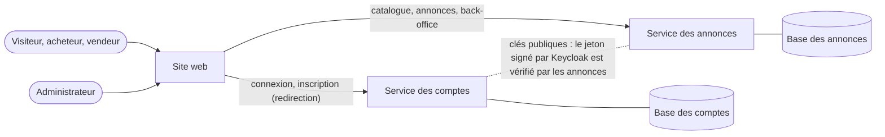
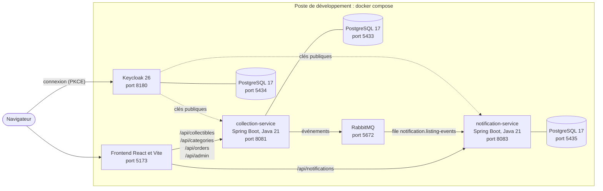
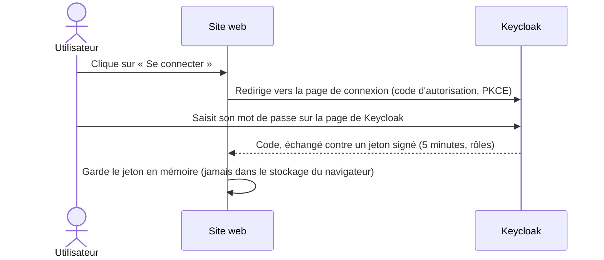
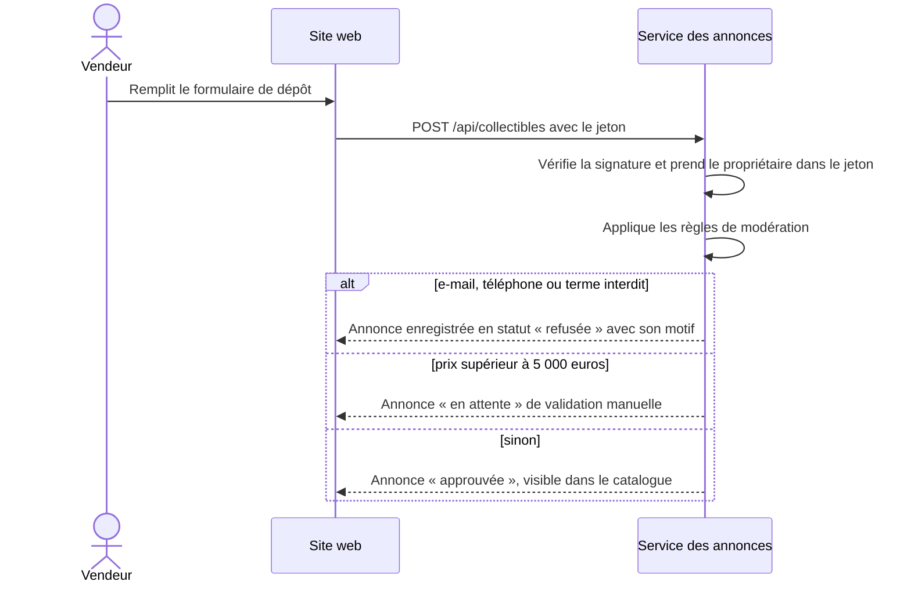
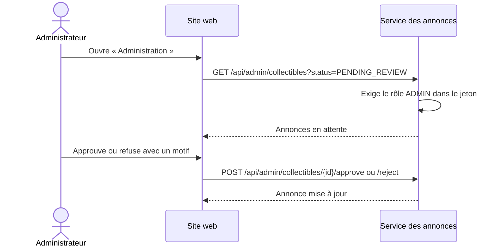
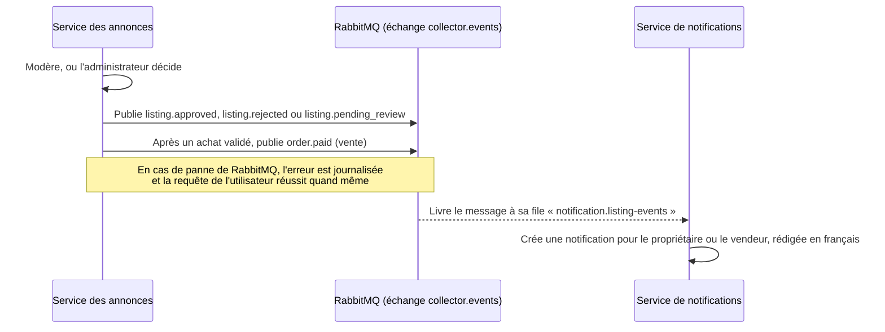
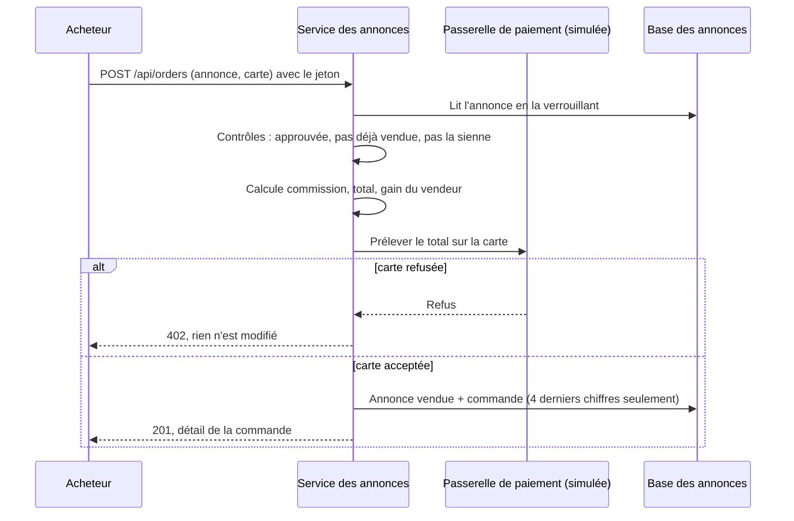
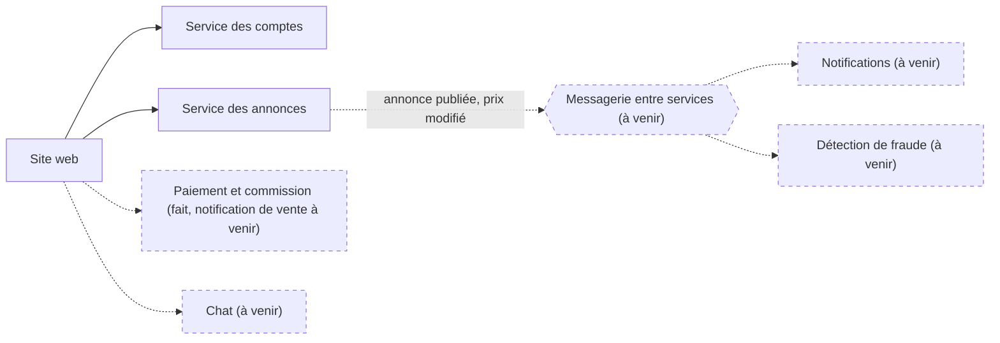

# Architecture

Ce document décrit les composants de Collector, leurs responsabilités et la manière dont ils communiquent. Il commence par une vue sans aucune technologie, puis donne la réalisation actuelle, les flux principaux et les décisions prises. Ce qui n'existe pas encore est marqué « à venir ».

## 1. Vue d'ensemble, sans technologie

Le site ne contient aucune donnée : il appelle les deux services. Chaque service possède sa base, et aucun service n'accède à la base de l'autre.

## 2. Responsabilités

| Composant | Responsabilités | Ce qu'il ne fait pas |
|---|---|---|
| Site web | Afficher le catalogue, les formulaires, la page « Mes annonces » et l'administration (annonces et catégories) ; lire les catégories depuis l'API, avec une liste de secours si elle ne répond pas ; réduire les grandes photos avant l'envoi ; garder le jeton en mémoire et le renouveler avant son expiration | Aucune règle métier : il ne décide ni de la modération ni des droits |
| Keycloak | Créer les comptes, vérifier les mots de passe, bloquer les essais répétés, émettre les jetons signés avec le rôle, créer le compte administrateur au premier démarrage | Ne connaît pas les annonces |
| Service des annonces | Stocker les annonces, leurs photos (une par annonce, en base) et les catégories, appliquer la modération automatique, vérifier le jeton et les droits, publier le catalogue, offrir le back-office (annonces et catégories) | Ne gère ni les mots de passe ni les comptes |
| Base des comptes | Persister comptes et mots de passe hachés | — |
| Base des annonces | Persister annonces, statuts et motifs de modération | — |

## 3. Réalisation actuelle

En développement, le serveur Vite joue le rôle de passerelle : il redirige `/api/collectibles`, `/api/categories`, `/api/orders` et `/api/admin` vers le service des annonces, et `/api/notifications` vers le service de notifications. En production, ce rôle reviendra à une passerelle ou à un contrôleur d'entrée (à venir).

## 4. Flux principaux

### Inscription et connexion

### Dépôt d'une annonce et modération automatique

### Validation par l'administrateur

### Événements d'annonces (RabbitMQ)

Le message est un texte (le nom de l'annonce) ; le vendeur, l'identifiant de l'annonce, le nouveau statut et le motif voyagent dans les en-têtes AMQP. Une vente suit le même principe avec la clé `order.paid` : en-têtes `orderId`, `listingId`, `sellerId` et `sellerNet` (le gain net, en texte pour éviter toute perte de précision). La file `notification.listing-events` est liée aux deux clés (`listing.*` et `order.paid`) : elle garde son nom pour ne pas laisser une file orpheline dans RabbitMQ.

L'événement de vente n'est envoyé qu'après validation (« commit ») de la transaction d'achat. Sans cela, un échec d'enregistrement après l'envoi préviendrait le vendeur d'une vente qui n'a pas eu lieu.

### Achat d'une annonce (paiement simulé)

Le verrou sur l'annonce fait attendre un second acheteur arrivé au même instant ; quand il obtient la main, l'annonce est vendue et il reçoit 409.

## 5. Décisions d'architecture

| Décision | Raison | Limite ou conséquence |
|---|---|---|
| Deux services séparés, une base chacun | Les comptes et les annonces évoluent à des rythmes différents ; une panne ou une faille de l'un n'ouvre pas la base de l'autre | Pas de jointure entre les bases : les annonces ne connaissent un vendeur que par son identifiant |
| Jeton JWT signé par Keycloak avec une clé privée (RS256) ; les services ne connaissent que les clés publiques | Aucun secret à partager entre services ; un service compromis ne peut pas fabriquer de jetons | Chaque service télécharge les clés publiques de Keycloak ; si Keycloak est arrêté, personne ne peut se connecter (les jetons déjà émis restent valables 5 minutes) |
| Le propriétaire d'une annonce vient du jeton | Impossible d'écrire au nom d'un autre en modifiant le formulaire | — |
| Modération exécutée dans le service des annonces, au moment du dépôt | Simple et immédiate, sans composant supplémentaire | Ajouter la détection de fraude ou les notifications obligerait à modifier ce service ; la messagerie entre services (à venir) lèvera cette limite |
| Rôle `ADMIN` porté par le jeton (`realm_access.roles`) | Le service des annonces décide des droits sans rappeler Keycloak | Un changement de rôle ne prend effet qu'à l'expiration du jeton, soit 5 minutes au plus |
| Les changements de statut sont publiés sur RabbitMQ, « au mieux » | Les notifications et la détection de fraude s'ajoutent sans modifier la modération ; une panne de RabbitMQ ne bloque jamais un dépôt d'annonce | Un événement peut être perdu si RabbitMQ est arrêté au mauvais moment ; en production, on utiliserait un journal d'envoi en base (patron « outbox ») |
| Paiement derrière une interface `PaymentGateway`, simulé pour l'instant | Aucun vrai argent à manipuler dans un projet scolaire ; un vrai prestataire (Stripe, par exemple) remplacerait la simulation sans toucher au reste | La simulation ne couvre ni le remboursement, ni la contestation, ni le versement au vendeur |
| Achat dans le service des annonces, avec un verrou sur l'annonce | Marquer vendue et enregistrer la commande doivent réussir ou échouer ensemble ; une seule base, donc une seule transaction | Si les commandes devenaient un service séparé, il faudrait une transaction répartie (patron « saga ») |
| Passerelle assurée par Vite en développement | Une seule adresse pour le navigateur, pas de réglage de partage entre origines | À remplacer par une vraie passerelle en production |

## 6. Évolutivité

Le sujet demande de pouvoir ajouter vite de nouvelles fonctionnalités (enchères, événements, bot d'avant-vente, analyse des ventes). L'architecture le permet ainsi :

- **Un nouveau besoin devient un nouveau service** : il a sa base, vérifie le même jeton et reçoit sa route dans la passerelle. Les services existants ne changent pas.
- **Les échanges entre services passeront par une messagerie** (à venir). Quand une annonce est publiée ou qu'un prix change, le service des annonces publiera un événement ; les notifications, la détection de fraude et l'analyse des ventes s'abonneront sans que le service des annonces les connaisse.
- **Chaque service se déploie séparément** : une image Docker par service, construite par la CI.

Cible, avec les composants à venir en pointillés :

