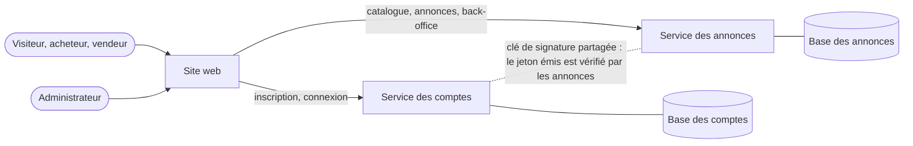
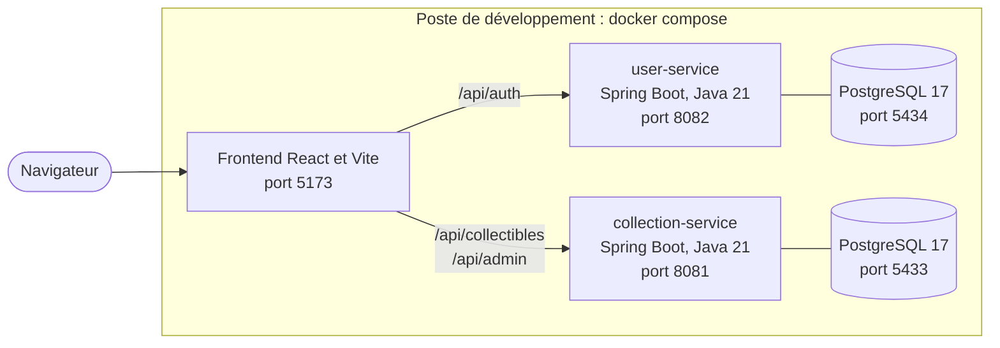
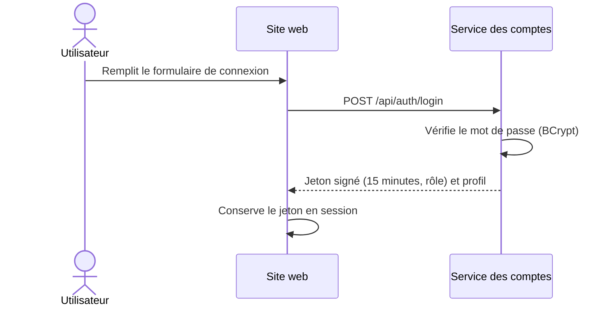
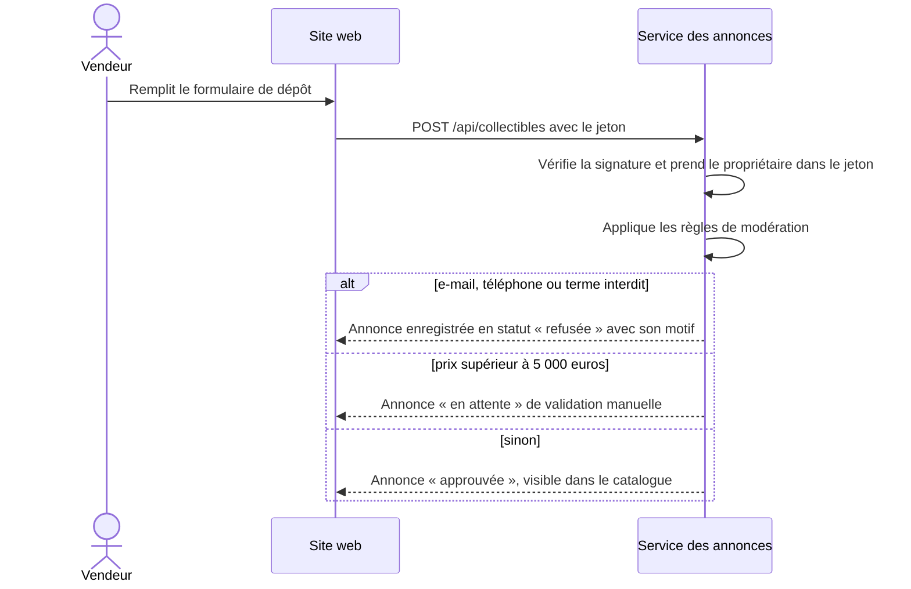
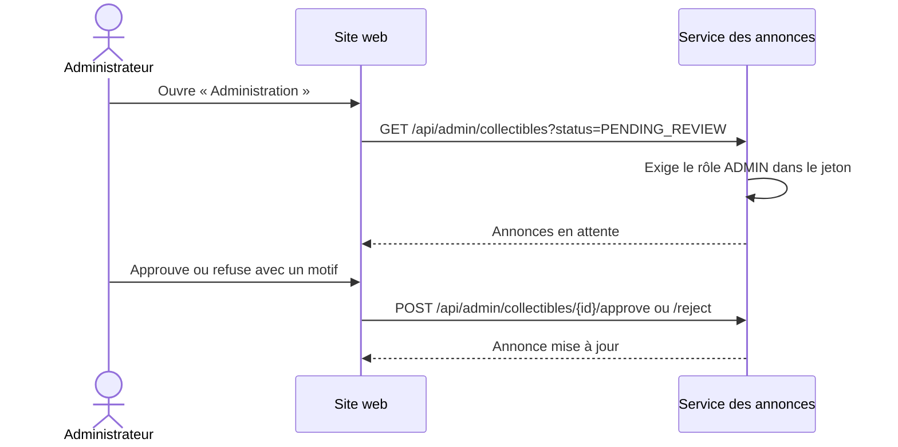
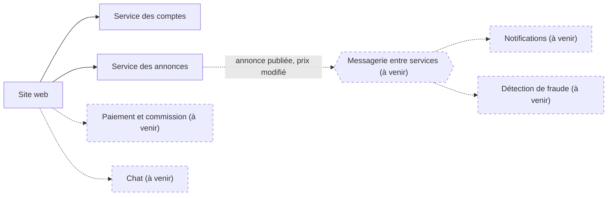

# Architecture

Ce document décrit les composants de Collector, leurs responsabilités et la manière dont ils communiquent. Il commence par une vue sans aucune technologie, puis donne la réalisation actuelle, les flux principaux et les décisions prises. Ce qui n'existe pas encore est marqué « à venir ».

## 1. Vue d'ensemble, sans technologie

Le site ne contient aucune donnée : il appelle les deux services. Chaque service possède sa base, et aucun service n'accède à la base de l'autre.

## 2. Responsabilités

| Composant | Responsabilités | Ce qu'il ne fait pas |
|---|---|---|
| Site web | Afficher le catalogue, les formulaires, la page « Mes annonces » et l'administration ; conserver le jeton le temps de la session | Aucune règle métier : il ne décide ni de la modération ni des droits |
| Service des comptes | Créer les comptes, vérifier les mots de passe, émettre les jetons signés avec le rôle, créer le compte administrateur au démarrage | Ne connaît pas les annonces |
| Service des annonces | Stocker les annonces, appliquer la modération automatique, vérifier le jeton et les droits, publier le catalogue, offrir le back-office | Ne gère ni les mots de passe ni les comptes |
| Base des comptes | Persister comptes et mots de passe hachés | — |
| Base des annonces | Persister annonces, statuts et motifs de modération | — |

## 3. Réalisation actuelle

En développement, le serveur Vite joue le rôle de passerelle : il redirige `/api/auth` vers le service des comptes, et `/api/collectibles` et `/api/admin` vers le service des annonces. En production, ce rôle reviendra à une passerelle ou à un contrôleur d'entrée (à venir).

## 4. Flux principaux

### Inscription et connexion

### Dépôt d'une annonce et modération automatique

### Validation par l'administrateur

## 5. Décisions d'architecture

| Décision | Raison | Limite ou conséquence |
|---|---|---|
| Deux services séparés, une base chacun | Les comptes et les annonces évoluent à des rythmes différents ; une panne ou une faille de l'un n'ouvre pas la base de l'autre | Pas de jointure entre les bases : les annonces ne connaissent un vendeur que par son identifiant |
| Jeton JWT signé avec une clé partagée (HS256) | Simple : le service des annonces vérifie le jeton sans appeler le service des comptes | Une clé symétrique partagée doit rester secrète ; une clé asymétrique est préférable en production |
| Le propriétaire d'une annonce vient du jeton | Impossible d'écrire au nom d'un autre en modifiant le formulaire | — |
| Modération exécutée dans le service des annonces, au moment du dépôt | Simple et immédiate, sans composant supplémentaire | Ajouter la détection de fraude ou les notifications obligerait à modifier ce service ; la messagerie entre services (à venir) lèvera cette limite |
| Rôle (`USER` ou `ADMIN`) porté par le jeton | Le service des annonces décide des droits sans rappeler les comptes | Un changement de rôle ne prend effet qu'à l'expiration du jeton, soit 15 minutes au plus |
| Passerelle assurée par Vite en développement | Une seule adresse pour le navigateur, pas de réglage de partage entre origines | À remplacer par une vraie passerelle en production |

## 6. Évolutivité

Le sujet demande de pouvoir ajouter vite de nouvelles fonctionnalités (enchères, événements, bot d'avant-vente, analyse des ventes). L'architecture le permet ainsi :

- **Un nouveau besoin devient un nouveau service** : il a sa base, vérifie le même jeton et reçoit sa route dans la passerelle. Les services existants ne changent pas.
- **Les échanges entre services passeront par une messagerie** (à venir). Quand une annonce est publiée ou qu'un prix change, le service des annonces publiera un événement ; les notifications, la détection de fraude et l'analyse des ventes s'abonneront sans que le service des annonces les connaisse.
- **Chaque service se déploie séparément** : une image Docker par service, construite par la CI.

Cible, avec les composants à venir en pointillés :

