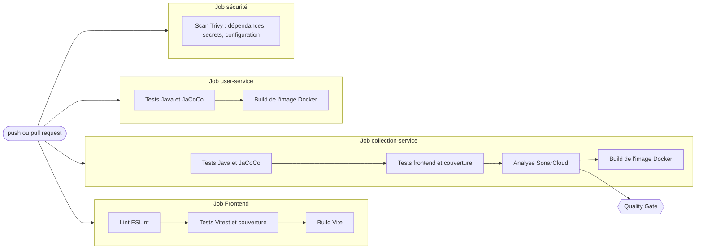

# Stratégie de tests

Ce document décrit les types de tests de Collector, leur rôle, leur place dans la chaîne d'intégration continue et ce qui n'est pas encore testé.

## 1. Les tests en place

| Type | Objectif | Outils | Où | Nombre |
|---|---|---|---|---|
| Unitaires | Vérifier une règle isolée : modération, validation d'identifiants, catégories, session | JUnit 5, Vitest | `ModerationRulesTests`, `ModerationServiceTests`, `api.test.ts`, `auth.test.ts`, `categories.test.ts`, `useCategories.test.tsx`, `PhotoFormatTests`, `RabbitListingEventPublisherTests`, `ListingEventsTests`, `photoFile.test.ts` | inclus ci-dessous |
| Composants (frontend) | Vérifier chaque écran comme le ferait un utilisateur : saisie, clics, messages d'erreur | Vitest, Testing Library, jsdom | `frontend/tests` | 191 au total côté frontend |
| Intégration de l'API | Faire traverser à une vraie requête toute la pile : contrôleur, validation, sécurité, base | Spring Boot Test, MockMvc, base H2 en mémoire | `src/test/java` des trois services | 132 au total côté Java (13, 95 et 24) |
| Sécurité applicative | Vérifier les accès : 401 sans jeton, 403 pour un utilisateur ordinaire sur les routes d'administration, propriétaire d'une annonce, compte administrateur | MockMvc avec de vrais jetons signés | `AdminAccessTests`, `OwnershipSecurityTests`, `AdminBootstrapTests`, `PhotoTests` | inclus ci-dessus |
| Analyse statique | Repérer les erreurs et mauvaises pratiques sans exécuter le code | ESLint, SonarCloud | CI | à chaque push |
| Dépendances et configuration | Repérer les failles connues, les secrets oubliés et les erreurs Docker | Trivy | CI | à chaque push |
| Couverture | Mesurer la part du code exécutée par les tests | JaCoCo (Java), v8 (frontend) | rapports de CI | à chaque push |
| Construction | Vérifier que chaque service s'empaquette et que l'image Docker se construit | Maven, Docker | CI | à chaque push |

Les tests d'intégration utilisent une base H2 en mémoire, jamais les bases PostgreSQL : ils sont rapides et ne dépendent d'aucun service lancé.

## 2. Place des tests dans la CI/CD

Le workflow GitHub Actions se déclenche à chaque push, à chaque pull request (dont celles de Dependabot) et à la demande. Les quatre jobs tournent en parallèle ; chaque étape suivante ne s'exécute que si la précédente a réussi.



| Moment | Tests exécutés | Effet d'un échec |
|---|---|---|
| Sur le poste, avant de pousser | `./mvnw -B verify`, `npm run test:coverage`, `npm run lint` | corriger avant le push |
| À chaque push | les quatre jobs ci-dessus | la CI devient rouge, le commit est signalé |
| Analyse SonarCloud sur `main` | couverture du code nouveau ≥ 80 %, notes A en fiabilité, sécurité et maintenabilité | le Quality Gate échoue |
| Pull request de Dependabot | mêmes jobs, sauf l'analyse Sonar (pas d'accès au secret) | la mise à jour n'est pas fusionnée |

## 3. Ce qui n'est pas encore testé

| Type de test | Pourquoi il serait utile | État |
|---|---|---|
| Charge et performance | Mesurer le temps de réponse du catalogue avec beaucoup d'annonces et d'utilisateurs | à faire |
| De bout en bout dans un navigateur | Rejouer le parcours complet : inscription, dépôt, validation par l'administrateur, catalogue | à faire |
| De contrat entre services | Garantir que le service des annonces comprend toujours le jeton émis par le service des comptes | à faire |
| De résilience | Vérifier le comportement du site quand un service est arrêté | à faire |
| D'accessibilité automatisés | Détecter les défauts de contraste et de navigation au clavier à chaque push | à faire |

## 4. Règles de travail

- Chaque fonctionnalité arrive avec ses tests, dans le même ensemble de commits.
- Chaque bug corrigé reçoit un test qui empêche son retour. Exemples : le test du proxy de développement après l'oubli de `/api/admin`, les tests de codes HTTP après l'erreur 401 à la place du 409.
- Les contrôles d'accès sont testés avec de vrais jetons signés, pas seulement avec des utilisateurs simulés.
- Le Quality Gate de SonarCloud bloque l'acceptation d'un code insuffisamment testé.

## 5. Lancer les tests

```bash
# Services Java
cd backend/microservices/user-service && ./mvnw -B verify
cd backend/microservices/collection-service && ./mvnw -B verify

# Frontend
cd frontend && npm run test:coverage
```
