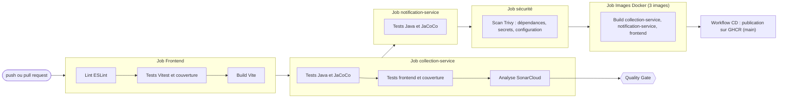

# Stratégie de tests

Ce document décrit les types de tests de Collector, leur rôle, leur place dans la chaîne d'intégration continue et ce qui n'est pas encore testé.

## 1. Les tests en place

| Type | Objectif | Outils | Où | Nombre |
|---|---|---|---|---|
| Unitaires | Vérifier une règle isolée : modération, validation d'identifiants, catégories, session | JUnit 5, Vitest | `ModerationRulesTests`, `ModerationServiceTests`, `api.test.ts`, `auth.test.ts`, `categories.test.ts`, `useCategories.test.tsx`, `PhotoFormatTests`, `RabbitListingEventPublisherTests`, `ListingEventsTests`, `photoFile.test.ts` | inclus ci-dessous |
| Composants (frontend) | Vérifier chaque écran comme le ferait un utilisateur : saisie, clics, messages d'erreur | Vitest, Testing Library, jsdom | `frontend/tests` (dont `PurchaseDialog.test.tsx`, `MyOrders.test.tsx`, `ordersApi.test.ts`, `catalogue.test.ts`, `CatalogueControls.test.tsx`, `Pagination.test.tsx`, `favorites.test.tsx`, `reviewsApi.test.ts`, `ReviewForm.test.tsx`, `InfoPage.test.tsx`) | 413 au total côté frontend |
| Intégration de l'API | Faire traverser à une vraie requête toute la pile : contrôleur, validation, sécurité, base | Spring Boot Test, MockMvc, base H2 en mémoire | `src/test/java` des deux services | 175 au total côté Java (140 pour collection-service, 35 pour notification-service) |
| Sécurité applicative | Vérifier les accès : 401 sans jeton, 403 pour un utilisateur ordinaire sur les routes d'administration, propriétaire d'une annonce, compte administrateur | MockMvc avec de vrais jetons signés (RS256, de la forme de ceux de Keycloak) | `AdminAccessTests`, `OwnershipSecurityTests`, `AdminBootstrapTests`, `PhotoTests`, `OrderApiTests`, `SoldListingGuardTests`, `SaleEventTests`, `RabbitSaleEventPublisherTests`, `OrderTrackingTests` | inclus ci-dessus |
| Analyse statique | Repérer les erreurs et mauvaises pratiques sans exécuter le code | ESLint, SonarCloud | CI | à chaque push |
| Dépendances et configuration | Repérer les failles connues, les secrets oubliés et les erreurs Docker | Trivy | CI | à chaque push |
| Couverture | Mesurer la part du code exécutée par les tests | JaCoCo (Java), v8 (frontend) | rapports de CI | à chaque push |
| Construction | Vérifier que chaque service s'empaquette et que l'image Docker se construit | Maven, Docker | CI | à chaque push |

Le paiement est couvert à trois niveaux : `CommissionCalculatorTests` (arrondis au centime, taux hors limites, la somme vendeur + commission − port redonne toujours le prix), `SimulatedPaymentGatewayTests` (clé de Luhn, carte expirée avec une horloge figée, carte toujours refusée, numéro masqué) et `OrderApiTests` (achat, 402, 403, 404, 409, 400, listes d'achats et de ventes, numéro de carte absent de la réponse).

Le suivi de commande est testé par `PurchaseOrderTests` (les transitions PAID → SHIPPED → DELIVERED et leurs interdits, sans base) et `OrderTrackingTests` (les rôles : vendeur expédie, acheteur confirme ; 403, 404 pour un tiers, 409 hors ordre, 401). `RabbitOrderStatusEventPublisherTests` vérifie les clés `order.shipped` / `order.delivered` et les en-têtes ; côté notifications, `ListingEventListenerTests` et `RabbitConfigTests` couvrent le bon destinataire (acheteur à l'expédition, vendeur à la réception) et les messages incomplets. `PublicListingTests` vérifie la fiche publique (approuvée et vendue visibles sans connexion, en attente ou inconnue en 404, identifiant invalide en 400) ; côté site, `ListingPage.test.tsx`, `route.test.ts` et `listing.test.ts` couvrent la page de détail, les adresses et la conversion des annonces. `DemoDataSeederTests` vérifie que les données de démonstration respectent les règles du site (modération, longueurs, catégories existantes) et ne se chargent qu'une fois. Un petit utilitaire de test, `PurchaseFlowSupport`, évite de recopier la mise en vente et l'achat dans chaque test.

Les tests d'intégration utilisent une base H2 en mémoire, jamais les bases PostgreSQL : ils sont rapides et ne dépendent d'aucun service lancé.

## 2. Place des tests dans la CI/CD

Le workflow GitHub Actions se déclenche à chaque push, à chaque pull request (dont celles de Dependabot) et à la demande. Les jobs s'enchaînent : frontend, tests et SonarCloud du service des annonces, tests du service de notifications, scan Trivy, puis construction des trois images Docker. Chaque job ne démarre que si le précédent est vert, et le CD ne publie les images qu'ensuite, sur `main`.



| Moment | Tests exécutés | Effet d'un échec |
|---|---|---|
| Sur le poste, avant de pousser | `./mvnw -B verify`, `npm run test:coverage`, `npm run lint` | corriger avant le push |
| À chaque push | les quatre jobs ci-dessus | la CI devient rouge, le commit est signalé |
| Analyse SonarCloud sur `main` | couverture du code nouveau ≥ 80 %, notes A en fiabilité, sécurité et maintenabilité | le Quality Gate échoue |
| Pull request de Dependabot | mêmes jobs, sauf l'analyse Sonar (pas d'accès au secret) | la mise à jour n'est pas fusionnée |

## 3. Ce qui n'est pas encore testé

| Type de test | Pourquoi il serait utile | État |
|---|---|---|
| Charge et performance | Mesurer le temps de réponse du catalogue avec beaucoup d'annonces et d'utilisateurs | à faire |
| De bout en bout dans un navigateur | Rejouer le parcours complet : inscription, dépôt, validation par l'administrateur, catalogue | à faire |
| De contrat entre services | Garantir que les services comprennent toujours le jeton émis par Keycloak | à faire : démarrer Keycloak dans la CI |
| De résilience | Vérifier le comportement du site quand un service est arrêté | à faire |
| D'accessibilité automatisés | Détecter les défauts de contraste et de navigation au clavier à chaque push | à faire |

## 4. Règles de travail

- Chaque fonctionnalité arrive avec ses tests, dans le même ensemble de commits.
- Chaque bug corrigé reçoit un test qui empêche son retour. Exemples : le test du proxy de développement après l'oubli de `/api/admin`, les tests de codes HTTP après l'erreur 401 à la place du 409. Dernier exemple : le test `markReadKeepsTheTimeOfTheFirstRead` a échoué dans Docker (horloge de Linux à la nanoseconde, base à la microseconde) alors qu'il passait sur macOS ; le service tronque désormais l'heure à la microseconde. Un test qui n'échoue que dans un autre environnement est une raison de plus de lancer les tests dans Docker et en CI.
- Les contrôles d'accès sont testés avec de vrais jetons signés, pas seulement avec des utilisateurs simulés.
- Les tests n'ont pas besoin de RabbitMQ : l'interrupteur `app.events.enabled=false` (fixé dans le `pom.xml` des deux services) empêche d'y publier ou d'y écouter, et le service de notifications est testé en appelant son écouteur directement. Un premier essai, qui désactivait seulement le démarrage de l'écoute, échouait quand Spring relançait un contexte de test mis en cache.
- Le Quality Gate de SonarCloud bloque l'acceptation d'un code insuffisamment testé.

## 4 bis. Exemple : le Quality Gate qui échoue

Après la livraison de l'écran d'achat, tous les jobs GitHub étaient verts mais le Quality Gate de SonarCloud échouait. L'interface publique de SonarCloud (`/api/qualitygates/project_status`) a donné la condition en cause : la **fiabilité du code nouveau** était notée C (il faut A), alors que la couverture (97,2 %), la duplication (0 %), la sécurité et la maintenabilité étaient bonnes. La cause : une promesse de chargement des catégories ni attendue ni terminée par un traitement d'erreur (`void` désormais, car les erreurs sont gérées dans `fetchCategories`).

Les autres remarques ont été traitées dans la foulée : groupes de filtres en `<fieldset>` (rôle natif), texte des libellés dans un `<span>`, `SyntheticEvent` au lieu de `FormEvent` déprécié, ternaire imbriqué extrait, constructeur de commande réduit de 10 à 4 paramètres.

Remarques volontairement laissées : les `!important` de la règle « mouvement réduit » (c'est la forme standard pour désactiver les animations, elles doivent gagner sur toutes les autres règles), la remarque « requête côté client » sur le catalogue (l'adresse est relative, sur le même site, et la catégorie et la recherche sont encodées) et l'usage de `java.util.Date` imposé par l'API d'AMQP pour l'horodatage d'un message.

## 5. Lancer les tests

```bash
# Services Java
cd backend/microservices/notification-service && ./mvnw -B verify
cd backend/microservices/collection-service && ./mvnw -B verify

# Frontend
cd frontend && npm run test:coverage
```
